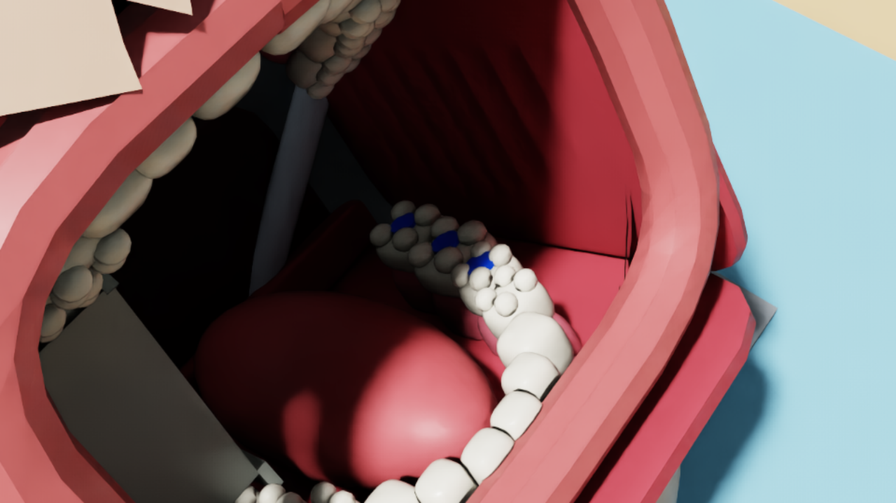

# Dental hygienist assistant: rinse, clear the mouth and return both tools

> Rinse the blue gel off the three marked lower teeth while keeping the mouth clear with the saliva ejector, then put both tools back in their holders.

A reclined phantom head holds a real-size adult typodont inside a printed face, cheeks, tongue, floor of the mouth and
throat. The right arm squeezes a bulb syringe to rinse a blue gel dot off each of three lower back teeth. The left arm
holds a saliva ejector where the water goes: the head is reclined, so the water runs off the teeth and back along the floor
of the mouth, and collects on the floor of the mouth against the throat sill, either side of the tongue. If too much
collects, it goes over the sill into the throat. Afterwards both tools go back to their holders.



## Why it matters

Rinsing off polishing-paste residue while suction keeps the mouth clear is a routine step of a dental cleaning. It is
done at every prophylaxis visit, by the hygienist with one hand while an assistant or the hygienist's other hand keeps the
saliva ejector in place.

| Occupation | US jobs (BLS Occupational Outlook Handbook, 2025) | The duty, in the source's words |
|---|---|---|
| Dental assistants (SOC 31-9091) | 388,600 | "Dry patients' mouths using suction hoses and other equipment" (BLS OOH); "assist dentist during dental procedures" (O*NET 31-9091.00) |
| Dental hygienists (SOC 29-1292) | 225,300 | "Clean calcareous deposits, accretions, and stains from teeth" (O*NET 29-1292.00); polishing, then rinsing the paste away (BLS OOH) |

Together 613,900 jobs. The task is the rinse and the suction only: no polishing, no plaque removal, no clinical treatment.

**What makes it hard for a robot.** Everything happens inside a real-size mouth: an opening 45 mm high and 64 mm wide,
two tools in it at once, molars about 30 mm behind the lips, an 8 mm gap between the second molar and the tongue for the
ejector, and water that runs toward the throat. The rinse must be aimed within a few millimetres. The squeeze must be
metered by grip, not by a button. Suction has to be where the water collects before it arrives, and stay until the mouth is
clear. Then both tools come out without hitting teeth or lips.

**Stand-ins, and why.**
- The *blue gel dots* stand in for prophy-paste residue. They are rinsed off by water, and you can see in a photo whether
  each one is gone.
- The *bulb syringe* is used as an operator-controlled spray suited to a gripper, standing in for the chairside
  air-water (3-in-1) syringe, which assistants and hygienists use to spray water into the mouth during a cleaning. A 3-in-1
  needs a dental unit and a thumb button, which a parallel gripper cannot press. A 2 oz bulb syringe costs about $2, sprays
  a stream of water into the mouth, and the hand holding it controls the spray, by how hard and how far it squeezes.

## The real build

All parts are standard and cheap. Prices are approximate (US, November 2026).

| Item | Part | Price |
|---|---|---|
| Typodont | Kilgore/Nissin 200-type 28-tooth typodont with screw-in teeth (generic M8011, or genuine Nissin D85SDP-200 series) | $30-40 generic, about $255 genuine |
| Shell | PETG and TPU 95A prints from `hardware/stl/` (about 450 g PETG, 60 g TPU) | $15-25 of filament |
| Bulb syringe | Medline DYND70280, 2 oz (60 mL) PVC ear/ulcer syringe, 52 mm bulb, 45 mm tapered nozzle | $2 |
| Saliva ejector | Benco 3743-620, clear with blue tip, 6.5 mm OD x 4.4 mm ID, 150 mm, bent into an L (95 mm leg) | $5.29 for 100 |
| Ejector handle | printed 14 x 80 mm handle (`ejector_handle.stl`), drilled 6.6 mm through; a commercial saliva-ejector valve for 1/4 in tubing also works | - |
| Suction | 12 V DC diaphragm vacuum pump, -80 kPa, 15 L/min free flow (for example the 559-BD-04V15L type), with a 12 V 2 A supply | $25-35 |
| Trap | 250 mL glass side-arm flask with a one-hole rubber stopper; 1/4 in ID silicone tubing, 2 m | $15 |
| Alternative suction | Yuwell 7E-A portable suction unit (18 L/min, 1000 mL jar) in place of the pump and trap | $150-200 |
| Measuring | pocket scale 0.01 g / 200 g; gauze squares; a bath towel; a 30 mL cup (the throat cup) on a 6 mm drain tube | $20 |
| Gel | water-based lubricant gel with a drop of blue food dye per 10 g | $5 |

**The shell** (`hardware/make_stl.py` writes the STL files from the same numbers as the simulation):

- `oral_tray.stl` (PETG) is the floor of the mouth, the cheeks, the throat sill and the throat behind it. Its floor is open
  round the lower arch: a horseshoe slot 2 mm clear of the gum, so that the typodont's gum comes up through it. The sill
  stands 8.5 mm above the floor, 64 mm behind the lower incisors. Behind the sill, a 6 mm hole drains the throat to the
  throat cup. Seal the slot round the gum, and the seams with the face shell, with aquarium silicone, so that the mouth
  holds water.
- `tongue.stl` (TPU 95A, 15 % infill) is an adult tongue at rest, 60 mm long and 26 mm wide between the molars. Two M3
  screws hold it, up through the floor 25 and 45 mm behind the lower incisors, on the midline.
- `jaw_spacer.stl` (TPU 95A) is the mouth prop: a bite block between the lower and upper right first and second molars.
  Flanges straddle the molars of both jaws, so it sits in one place on each. It holds the jaws 28 degrees open, 45 mm
  between the incisal edges.
- `face_shell.stl` (PETG) and `lips.stl` (TPU) form the face. The opening between the lips is a rounded rectangle 45 x
  64 mm: a wide-open mouth with the cheeks retracted, as for work on the back teeth. The shell leaves out the patches that
  would meet the typodont's gum or bases. There, the typodont's own gum and base show.
- `stand.stl` (a 160 x 130 x 4 mm plate and a 70 x 130 x 40 mm block under the back of the head) holds the head with its
  crown toward the robot, reclined so that the lower occlusal plane is at 35 degrees to the table. The lower incisal point
  is 0.28 m in front of the arms' base line and 60 mm above the table.
- `bulb_holder.stl` (a ring 32 mm across and 70 mm high, its post on the outer side, over a drip cup 64 mm across and 14 mm
  deep) stands at (0.36, -0.20), on the right arm's side. `ejector_cradle.stl` (two notched posts, 105 mm high) stands at
  (0.36, 0.24), on the left arm's side; the ejector lies in it with its bent leg toward the head.

### Mounting the typodont

Positions are in millimetres in the mouth's own frame, from the lower incisal point: *p* back along the lower occlusal
plane, *l* to the patient's left, *c* toward the upper jaw. `hardware/make_stl.py` uses the same numbers (`TYPODONT`,
`BASE_SCREWS`, `FACE_PINS`), and checks that no printed part meets the typodont.

- **The typodont's bases.** No published size was found for the bases of Kilgore/Nissin 200-type typodonts or the
  generic M8011: measure yours and record it. The parts are drawn for a nominal base under each jaw 75 mm wide (*l* -37.5 to
  37.5) and 58 mm deep (*p* -4 to 54 for the lower jaw), 10 mm high under the gum. Each jaw is then 30 mm from its
  occlusal plane to the bottom of its base. In the simulation the gum reaches *c* = -17.5 to -19.5 mm. The lower base's
  top is at *c* = -20, its bottom at -30. If your base differs, change `TYPODONT` and print again.
- **The lower jaw to the tray.** The tray's floor (*c* -17 to -14) stands 3 mm above the lower base on four bosses, 8 mm
  across with 3.4 mm holes, at (*p*, *l*) = (28, 35), (28, -35), (52, 11) and (52, -11). Drill 2.5 mm pilot holes in the
  base through the bosses and screw the tray down with four M3 x 12 screws. Seal the heads with silicone.
- **The upper jaw at the opening.** The typodont's own hinge sets the axis. The mouth prop (`jaw_spacer.stl`) sets the
  opening: it sits between the right first and second molars of both jaws (*p* 26 to 46, *l* -31 to -17 on the lower
  jaw), with 1.5 mm flanges 3.5 mm deep on the cheek and tongue sides of each jaw's molars. A rubber band round the two
  bases, behind the hinge, keeps both jaws pressed onto it. The prop is on the right, away from the three target teeth.
- **The face shell to the tray.** Two 3.9 mm pins on the inside of the shell, at *l* = 39.5 and -39.5, *c* = 20, point
  back along *p*. They go 7 mm into 4.3 mm bores in bosses at the front ends of the cheek walls (*p* 8.6 to 16.6).
  Push the shell back on the pins until it meets the cheek walls' front edges.
- **On the stand.** With the nominal base, the lower base's back edge is 0.5 mm above the stand's plate; put a shim
  there. A deeper base needs a window cut in the plate.

**Calibrate once, and write the numbers on the rig:**

1. *Bulb.* Squeeze the full bulb between two flat plates (or the robot's fingers) at 2, 4, 6, 8 and 10 mm and weigh the
   water out each time. The simulation uses 1.0 mL per mm (a 2 oz bulb gives about 40 mL over its full squeeze).
2. *Gel dot.* Put a 4 mm dot (0.02 g) on a tooth and rinse it from 18 mm with metered volumes from a syringe. It should
   come off with 0.3-0.5 mL. Adjust the gel's water content until it does.
3. *Suction.* Time the ejector draining 20 mL from a cup. The simulation uses 4 mL/s.
4. *Water at the sill.* Drip water from a syringe onto the floor behind the last left molar until it crosses the sill.
   The simulation uses 1.24 mL a side (a wedge 8.5 mm deep at the sill, reaching 12 mm forward over the floor tilted at
   35 degrees, 24 mm wide).
5. *Gauze.* The 0.3 g limit for water left in the mouth is to be calibrated on the real rig with a hand-performed rinse:
   rinse the three dots by hand with the ejector held where the water collects, wipe with gauze and weigh it.

## A real trial and its score

The throat cup (30 mL, 32 mm across, 45 mm high) stands on the table at (0.21, 0.10) m from the midpoint between the arm
bases, beside the stand, on the drain tube from behind the sill.

Before the trial: refill the bulb with 20.0 g of water; weigh the bulb, the throat cup, the trap and the dry towel; put
a fresh dot on each of the three teeth and take a photo; start the video.

After the trial, once both tools are out of the mouth:

1. Photograph the three teeth: is each dot gone? A blue stain of dye left on the tooth, with no gel, counts as removed.
2. Wipe the mouth (the floor against the sill, the vestibules, tongue and floor) with pre-weighed gauze and weigh it:
   water left in the mouth.
3. Weigh the throat cup: water that went past the sill.
4. Weigh the towel: water sprayed outside the mouth.
5. Weigh the trap and the bulb, as a balance check: the water squeezed out equals the water in the trap, left in the
   mouth, in the throat cup, on the towel and in the bulb holder's drip cup.
6. Check on the video that both tools were released in their holders, and that both grippers stayed 3 cm or more from
   both tools and both holders for 1 s.

| Outcome | Score |
|---|---|
| Throat cup gained over 0.2 g, towel over 0.5 g, gauze over 0.3 g (to be calibrated on the real rig), or a tool still in the mouth at the end | 0 |
| Otherwise, for each blue dot rinsed off completely | 0.25 each, up to 0.75 |
| All three dots off, and the bulb and the ejector each in its own holder (within 1 cm, upright within 10 degrees), with both grippers 3 cm or more from both tools and both holders, for 1 s | 1.0 |

Water squeezed out away from the patient, for example while picking up the bulb, falls into the holder's drip cup and
does not count.

## In simulation

```bash
python -m unittest -v test_mouth                                    # the water model and the score, on hand-built trials
python run_demo.py OUT                                             # the scripted demo through inspect-robots run, frames in OUT
python run_demo.py OUT --no-frames --mode skip                     # a failure check (skip, nosuction, outside, none)
python run_demo.py OUT --no-frames --mode none --width 1920 --height 1080 --mouth-shot setup_mouth.png   # the close-up still
# a policy (POLICY) on the task, as Dream-1 runs it:
inspect-robots run --embodiment yam_arena --policy POLICY -E task=task.py -E object_jitter=0 -E control_hz=20 \
  -E cam_width=320 -E cam_height=176 --scorer task_score --max-steps 1600 --instruction "$(python -c 'import json;print(json.load(open("task.json"))["instruction"])')"
```

One trial takes up to 1,600 control steps (80 s simulated); the demo ends after 1,035 steps (51.8 s), which takes about 4 minutes on one RTX 4090. There is no randomness (object

Model run: Dream-1 on the task's own instruction and 1,600-step limit (320 x 176 cameras, 10 rows per request), one session from the first action to the end: task score 0.0. The video is `model_run.mp4`.
jitter 0); the demo's score does not depend on the seed.

**What is simulated.** The arms, the tools and the head are rigid bodies on GPU physics. The bulb has soft contacts, so
the fingers sink into it as they squeeze. Its centre of mass is 10 mm below its middle, where the water lies. The squeeze is
read from the gap between the fingers. The water is a reduced
model in `mouth.py`:

- The bulb sends out 1.0 mL for each millimetre the gap across it closes, past its deepest squeeze so far. On release it
  draws air back in.
- The stream leaves the nozzle at 0.5 m/s and falls under gravity. It lands on the first surface it meets: the face
  outside the lips (spill), a lower tooth (a gel dot if within 3.5 mm of it), the tongue, or the floor.
- Water on teeth and tongue runs off within about 0.4 s. A third goes to the cheek vestibule on that side, which drains
  back along the floor in about 2.5 s; the rest runs straight back. The head is reclined 35 degrees, so the floor slopes
  down toward the throat, and water collects on the floor of the mouth against the throat sill, either side of the
  tongue (*p* 52 to 64 mm, *l* 8 to 32 mm each side). Each side holds 1.24 mL below the top of the sill: a level wedge
  8.5 mm deep at the sill, reaching 12 mm forward. The excess goes over the sill into the throat cup.
- The ejector draws 4 mL/s from the water its 8 mm tip is in, its centre within 8 mm above the floor: against the sill on
  either side, or in a cheek vestibule.
- The full score needs both grippers 3 cm or more from both tools and both holders (each taken as round segments a
  little larger than the part) for the whole 1 s hold.
- A gel dot is rinsed off once 0.4 mL has landed within 3.5 mm of it.

What is drawn: a stream of drops from the nozzle to where it lands, a level water surface against the sill on each side
that grows as water collects, a film in the vestibule, and drops going into the ejector. A grey mouth prop between the
right molars holds the jaws open, as in the real build. The scorer (`mouth.score`, called each step from `task.py`) follows
`task.json`'s scoring line by line. The 1 s hold of the full score is timed in `task.py`.

**The scripted demo** (`dentaldemo.py`) reads the tools' poses, which the cameras see, and its own joints. It steers on
the exact poses of the visible tools read from the simulator. It uses the head's geometry and the stream's speed, never
the water ledger or the score. A policy gets only the cameras and the joints. The right hand takes the bulb from its ring
and turns it over the drip cup to lean 52 degrees back, its nozzle pointing a little toward the patient's left. The left
hand puts the ejector's tip on the floor of the mouth where the water collects, left of the tongue, 6 mm in front of the
throat sill and 5 mm above the floor, and keeps it there, closing the loop on where the tip is seen. The right hand leans the nozzle in from the right side of the opening over each tooth in turn, aimed
along the bulb's axis as it is seen and held a few millimetres high for the stream's fall. Over each tooth it closes the
fingers' target by 1.6 mm over 0.8 s, about 1 mL. Then it takes the bulb out, stands it upright over its ring, lowers it
in, lets go and draws the fingers back and up, clear of the bulb and its holder. The left hand waits for the vestibule to
drain, then takes the ejector out, squares it, lays it in its cradle, lets go and lifts the fingers 8 cm.

**The close-up still** `setup_mouth.png` (above) shows the open mouth and the three gel dots before a trial. It is taken
on a run of its own that does nothing else (`--mouth-shot`, with `--mode none`): on that run only, `task.py` moves the
overhead camera in front of the face, looking in over the lower lip, and keeps the middle half of its picture. Scored runs
never move a camera.

**Failure checks** (`TASK_DEMO=<mode>`):

| Mode | What it does | Score |
|---|---|---|
| `full` | the demo | 1.0 |
| `skip` | rinses two teeth only | 0.5 |
| `nosuction` | rinses without the ejector: water collects against the sill and is left in the mouth | 0 |
| `outside` | squeezes with the nozzle outside the lips: water on the towel | 0 |
| `none` | does nothing | 0 |

## Files

| File | What it is |
|---|---|
| `task.py` | the scene, the per-step water and score bookkeeping, and the demo's entry point |
| `mouth.py` | the head's geometry (real tooth sizes), the water model and the score; no simulator |
| `parts.py` | meshes and colliders of the head, the tools and the holders |
| `dentaldemo.py` | the scripted demo and the failure modes |
| `run_demo.py` | runs the demo as a policy through `inspect-robots run`, with the same guards as any policy |
| `test_mouth.py` | offline checks of the water model and the score |
| `mechkit.py`, `demokit.py`, `steptime.py` | helpers: USD props for a task file, closed-loop demos, step timing |
| `hardware/make_stl.py`, `hardware/stl/` | the printable parts, and the check that they clear the typodont |
| `setup_mouth.png` | the close-up still of the open mouth |

## Assets and licence

Every mesh is generated by the code in this folder (tooth sizes from standard adult crown dimensions). No third-party
meshes, scans or textures. The robot and the station come with the harness.

## Licence

MIT
