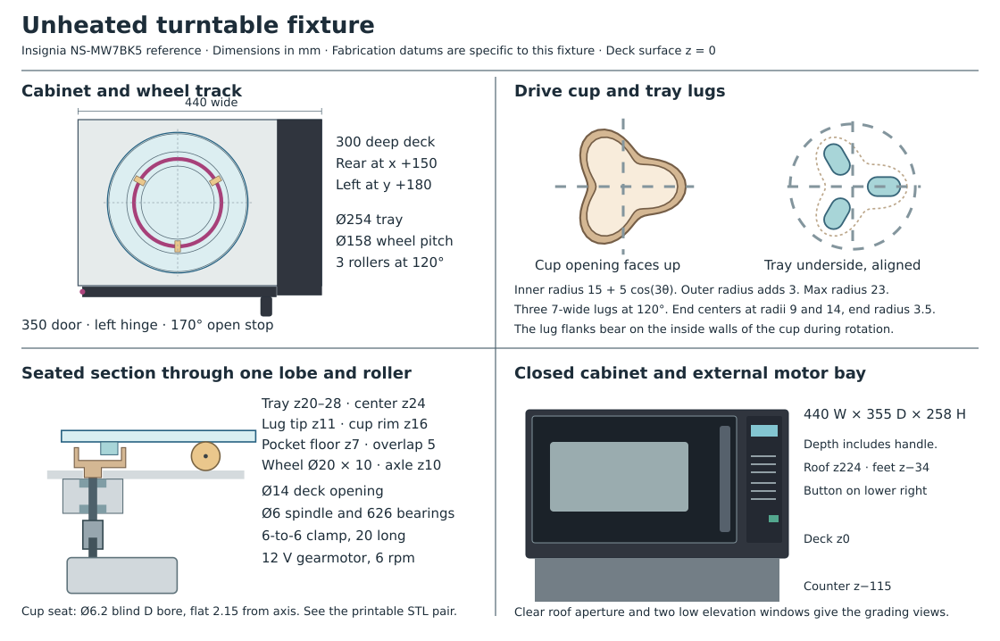
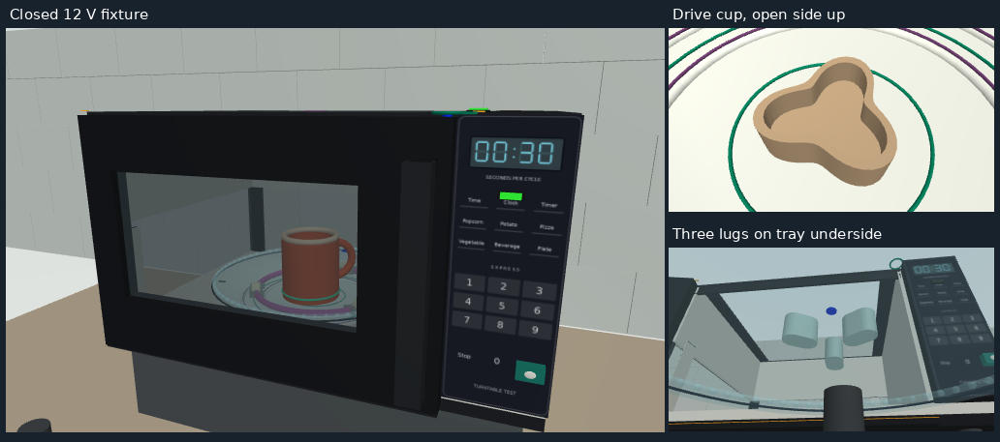

# Build the unheated turntable fixture

The retail reference is the black **Insignia NS-MW7BK5**, Best Buy SKU **6568217**. The US listing offered the complete oven for **$59.99 on November 19, 2026**. Its matching kit comes with the oven. Page 7 of the manual shows the removable glass tray with three underside lugs, the ring with three wheels, and the recessed three-lobed shaft coupler on a D-shaped drive. Page 11 shows how they nest. Buy by this exact model when sourcing a reference set. Insignia directs replacement-part inquiries to its customer service on page 19. [Best Buy listing and front photograph](https://www.bestbuy.com/product/insignia-7-cu-ft-compact-microwave-black/J2FPJKSY3Q/sku/6568217) · [Insignia user guide](https://files.bbystatic.com/ANTHtc8TH5kQ3VbXTyfvGw%3D%3D/User%2BGuide)

| Feature | Retail reference | Scored bench fixture |
|---|---|---|
| Envelope | 439.5 W × 354.5 D × 258.2 H mm in the manual, p. 20 | Nominal 440 × 355 × 258 mm, including the closed handle and feet. The motor plinth sits below the feet. |
| Enclosure | Black cabinet, left hinge, tall right-edge pull, dark door window, narrow right-hand keypad | Same arrangement and proportions. Clear inspection windows in the roof, rear and left wall expose the parts to cameras. |
| Turntable | Ø254 mm glass, three molded lugs, three-wheel ring, recessed drive cup | Ø254 mm clear acrylic with raised lip, three bonded lugs, freely turning wheels and a three-lobed cup. The mark positions, fits and wheel pitch below are fixture dimensions. |
| Operation | The manual describes PL0 as a fan setting on p. 13. The retail Start/+30sec. key defaults to full cooking power in standby. | The green button runs only a separate 12 V gearmotor. The other keypad legends are printed. A normally-open door switch cuts motor power. |

**Run the powered trial only on the standalone fixture.** Keep the retail oven unplugged for comparison or a dry fit of its own accessories. Leave its cabinet, electrical system and door interlocks intact. The fixture can be built without buying an oven. Its printed cup and lugs form a matched pair independent of OEM replacement-part tolerances.





## Parts and cost

| Qty | Part or material | USD |
|---:|---|---:|
| 1 | Aslong JGY370-12-6 gearmotor, 12 V DC, nominal 6 rpm, Ø6 × 14 mm D output. Confirm this shaft size on receipt. [Supplier listing and drawing](https://www.robotshop.com/products/aslong-motor-jgy370-12v-6rpm-high-torque-worm-gear-motor) | 8.59 |
| 1 | Enclosed current-limited 12 V, 1 A DC adapter and matching jack | 14 |
| 1 set | 5 V ATmega328P Nano-compatible board and regulated 12 V to 5 V buck converter | 12 |
| 1 set | Normally-open roller-lever door switch rated at least 2 A at 12 V DC, momentary green Start key, 12 V green pilot light, 1 A inline fuse and holder | 13 |
| 1 set | IRLZ44N, SB560 flyback diode, 100 Ω, 100 kΩ, 22 kΩ and 10 kΩ resistors, terminals and wire | 6 |
| 1 set | Two 626-2RS bearings (6 × 19 × 6), Ø6 × 50 steel shaft, 6-to-6 split clamp 20 long, bearing block | 15 |
| 1 | 610 × 915 × 4 clear polycarbonate sheet for roof, windows and door | 32 |
| 1 set | 6 mm birch sheet, light liner, black cabinet skin/film, frame angles, 3 mm aluminium motor bracket, hinges, handle and fasteners | 22 |
| 1 | Ø254 × 8 clear PMMA disk and 5 mm clear half-round strip for rim | 18 |
| 1 set | PETG or nylon for drive cup, tray lugs, ring and forks, three nylon wheels, three Ø3 axles, track strips and acrylic-compatible adhesive | 10 |
| 1 set | Empty orange ceramic mug, six drying posts with silicone tops, paint or film for marks | 9 |
| | **Estimated materials for the fixture** | **159.59** |

The motor has a quoted vendor price. The other lines are shop estimates. The estimate excludes a retail oven, cameras, arms, tools, shipping and labor.

## Fabrication

All dimensions below are millimetres. Use the center of the spindle as the plan origin, +x toward the back and +y to the left as viewed from the front. The deck surface is z0.

1. **Cabinet and deck.** Cut a 300-deep × 440-wide deck. Set the axis 150 from the front and 180 from the left edge. Cut a Ø14 shaft opening and keep the central deck thickness at 6. Fit smooth concentric half-round guides, section radius 2.5, at radii 66 and 92. The wheels run on the flat deck between them. Set the feet at z−34 on a covered 81-high plinth, so the deck is 115 above the counter. Enclose the motor underneath.
2. **Spindle and motor.** Fasten a 42 × 42 × 24 bearing block under the deck using four M3 bolts on a 32 square. Bore Ø12 through and recess one Ø19 × 6 bearing flush into each end. Run the Ø6 shaft through the bearings. File the upper 9 of the shaft to a D, 5.0 across the flat to the opposite edge. Set its top at z4. Center the 20-long split clamp at z−45. Mount the gearbox face at z−61, aligning its output with the spindle and leaving about 1 between shaft ends. Transfer the gearbox mounting pattern from the supplied motor to the bracket. With power disconnected, loosen the clamp to check that the spindle turns freely, then retighten.
3. **Drive cup.** Print one cup and three copies of the lug at 100% in millimetres. Deburr the contact faces. The cup neck is Ø12 with a Ø6.2 blind D bore, flat 2.15 from the axis. Seat it upright on the top of the D shaft. Its underside is at z2, pocket floor at z7, and rim at z16. The continuous three-lobed inside wall drives the lugs. One lobe points along +x at reset. The CAD generator supplies the same surfaces to the simulator and the STL export. [Drive cup STL](print/drive-cup.stl) · [Tray lug STL](print/tray-lug.stl) · [Parametric source](coupling.py)
4. **Tray.** Round the edges of the Ø254 × 8 disk. Bond the 5-wide half-round lip flat side down, centered at radius 124.5 on top. Lay out three radial centerlines at 0°, 120° and 240° on the underside. Each lug occupies radii 5.5–17.5 along its centerline, is 7 wide, and projects 9 downward. Locate the centers of its rounded ends at radii 9 and 14. Bond to within 0.5 of the template. At nominal seating the tray underside is z20, the lug tips are z11, and the cup overlaps the lugs by 5. The finished acrylic assembly weighs approximately 480 g.
5. **Ring and rollers.** Bend or print a round-section Ø6.8 hoop on a Ø158 pitch circle. Leave a 26-wide tangential interruption at each of the three wheel positions, spaced 120° apart. Use two 32 × 7 × 2 fork cheeks per wheel, centered at radii 72.5 and 85.5. Bridge the cheeks at their ends and attach them to the hoop. Fit three freely turning Ø20 × 10 nylon wheels on retained Ø3 radial axles, with Ø3.2 wheel bores. The axle plane is z10 when seated. Put the first wheel toward the door at reset.
6. **Enclosure and controls.** Make the roof top z224. Leave a 292-deep × 296-wide clear roof aperture centered on the spindle. The upper rear and left walls have light liners and black outer skins. Use clear glazing from z0 to z106 across the rear (312 clear width) and left side (about 292 clear depth). Put the hinge at (−161, +172). The 350-wide door extends from z−17 to z221, opens 170° to the left, and has a smoked or clear 246 × 128 window. Put the pull 332 from the hinge with its outer face 44 in front of the hinge axis. Leave 2 lateral clearance between the closed door and keypad housing. Mount the spring-return Start key at (−174, −244, z39). The 80 × 222 face artwork can be printed at actual size. [Face artwork](fascia.png)
7. **Witness marks.** Mark the ring hoop magenta and the tray mid-edge dark. Add an 8-wide blue stripe from radius 103 to 127 on the tray top, continuing over the edge. Put a blue center dot on top. Give the mug a Ø10 yellow dot inside at the center, 7 above the foot, a mint band around the wall centered 6 above the foot, and a cream lip line centered at 67. Mark roof circles of radii 6 and 12 at the axis. Place four dark cardinal ticks on the deck at radius 139 and circles at radii 35 and 78 for the mug and 67 and 91 for the ring. Put two yellow ticks and a sill line at x−161. Add a blue dot on top of the door 344 from the hinge and a fixed green hoop of radius 10 directly above its closed position. Adjust the switch to open when the dot leaves this hoop. Place a scale with 5 mm ticks beside each elevation window, with colored intervals at z5–15, 20–28, 30–38 and 90–101. Route the green pilot light to the front and top of the keypad housing so power is visible in both views.

To regenerate the printable parts with Python and NumPy, run the following from this task folder.

```bash
python coupling.py --out /tmp/turntable-parts
```

## No-heat test cycle

Use an external enclosed adapter. Assemble and adjust everything with the 12 V jack disconnected. The only powered mechanisms in the fixture are the low-voltage motor and its controls.

| Circuit | Wiring |
|---|---|
| Supply | Adapter positive → 1 A fuse → +12 V bus. Feed regulated 5 V from the buck to the Nano's 5 V pin. Connect logic and adapter grounds. |
| Hardwired door cutout | +12 V → switch COM. Switch NO → motor positive. The switch conducts only with the door closed. Connect that switched positive terminal to D3 through 22 kΩ, with 10 kΩ from D3 to ground. |
| Motor switch | Motor negative → IRLZ44N drain, source → ground. D9 → 100 Ω → gate, with 100 kΩ gate-to-ground. Fit the SB560 across the motor, striped end to motor positive. |
| Visible controls | Start button between D2 and ground. Put the polarized 12 V green indicator across the motor terminals. |

Load the supplied 30-second sketch. Cover the motor bay and connect the adapter. Before collecting data, press Start with the door open and verify the lamp stays dark. Close the door, release and press Start. Verify that the lamp lights and the drive runs for 30 seconds. Open the door during a second run and verify that it cuts power immediately, including if Start is held. Reclose the door and confirm the drive waits for a fresh press. Check one loaded turn counterclockwise from above in approximately 10–12 seconds. Disconnect the adapter before adjusting the fit or direction. Wait for the lamp to go dark and the tray to stop before reaching into the guard. The recorded results are from simulation. Physical construction and commissioning are pending. [Timer sketch](drive_timer/drive_timer.ino) · [Operator sequence for a scored trial](README.md#run-one-real-trial-without-heating)
