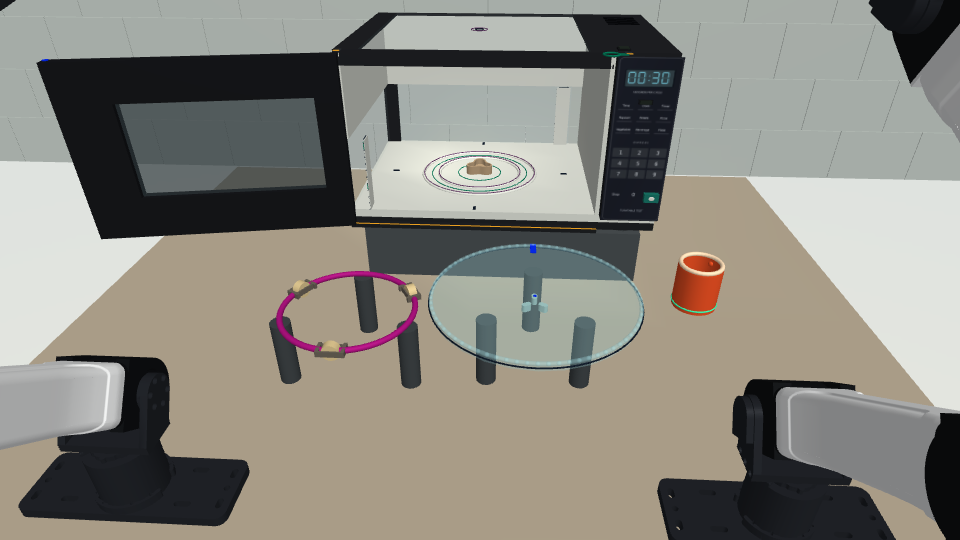
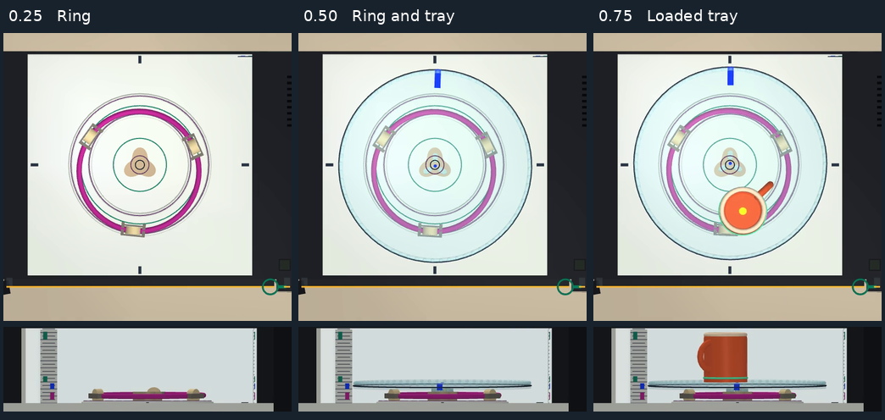
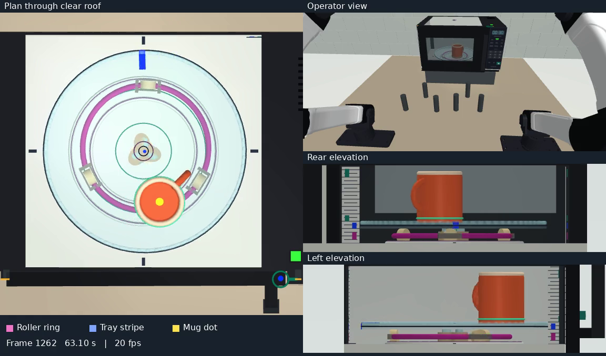

# Reinstall a microwave turntable after cleaning

Seat the roller ring, fit the tray's three underside lugs into the three-lobed drive cup, and set the mug off center. Withdraw the grippers, close the door and press the green Start key. A blue stripe on the tray and a yellow dot in the mug show whether the drive carries both through one uninterrupted turn.

The retail reference is the **Insignia NS-MW7BK5**, a 0.7 cu. ft. black countertop microwave. Best Buy listed SKU **6568217** for **$59.99 on November 19, 2026**. The matching 254 mm glass tray, three-wheel roller ring and drive cup are pictured together on pages 7 and 11 of the manual. The simulation follows the cabinet dimensions, windowed left-hinged door, vertical pull, right keypad and keyed assembly. [Retail model](https://www.bestbuy.com/product/insignia-7-cu-ft-compact-microwave-black/J2FPJKSY3Q/sku/6568217) · [Insignia user guide](https://files.bbystatic.com/ANTHtc8TH5kQ3VbXTyfvGw%3D%3D/User%2BGuide)

**The scored physical trial uses a standalone 12 V replica.** Its clear acrylic tray and inspection windows make the roller ring and mug visible with ordinary cameras. Only the gearmotor receives power from Start. The door switch cuts power on opening, and the timer stops after 30 seconds. Keep any reference microwave unplugged. The manual describes the retail PL0 setting as fan-only. The fixture drawings, printable coupling, wiring, firmware and commissioning procedure are included. The estimated fixture materials cost is $160, independent of the retail oven. [Build guide](FIXTURE.md) · [Dimensioned drawing](fixture.svg)



## Set up and reset

Use a 1,100 × 1,100 mm counter centered at (300, 0) mm. Measure x away from the robot and y to its left, from the midpoint between the two YAM bases at (0, ±305). Heights in this section are above the counter. Center the spindle at **(565, 0)** with the cavity deck **115** high. The cabinet is 440 wide × 355 deep including the handle × 258 high above its feet. Its 350-wide door starts 170° open.

| Loose object | Center (x, y), mm | Starting pose |
|---|---:|---|
| Three-wheel nylon roller ring, Ø158 pitch, Ø20 × 10 wheels | (202, 136) | Axles 87 high, one wheel toward the robot. Use three Ø24 silicone-topped posts on radius 79 at 0°, 110°, 250° from +x toward +y. |
| Clear acrylic tray, Ø254 × 8, raised rim, about 480 g | (226, −85) | Mid-edge 93 high, lugs underneath, stripe and one lug toward +x. Three Ø24 posts on radius 69 at 0°, 125°, 235°. |
| Empty orange ceramic mug, Ø62 × 70, 190 g | (365, −322) | Upright on the counter. Handle toward (+x, −y), about 48° right of +x. Yellow dot visible inside. |

Use seed 0. For a physical reset, disconnect the fixture adapter, clear the cavity and restore the loose parts to their posts and mark orientations. Index one empty cup lobe toward +x. If indexing is needed, loosen the split clamp with power disconnected, align the spindle, retighten and close the motor bay. Open the door, release Start and reconnect the adapter. Both grippers start open with each arm's six joint angles at [0, 0.65, 1.20, −0.30, 0, 0] radians.

## Run one real trial without heating

1. Keep the retail microwave unplugged. Use the enclosed 12 V replica after its door-cutoff and timeout checks have passed. Start the cameras with the guard open and the motor lamp dark.
2. Seat the ring in the track and lower the marked tray until its three lugs nest in the drive cup. Place the empty mug off center and withdraw both grippers past the yellow sill.
3. Close the guard until the blue latch dot is in the green circle. Release, then press the green **Start** key on the fixture. The lamp lights and the low-voltage motor turns the tray. Film the blue stripe and yellow mug dot crossing all four quarters together.
4. Stop grading at the first complete turn or the 70-second trial limit. The fixture cuts motor power 30 seconds after Start. Opening the guard cuts power earlier. Wait until the lamp is dark and the tray has stopped before reaching in. Disconnect the adapter before resetting the spindle or making adjustments.

## Grade the observable placements

Record an overhead view through the roof and one level elevation through an inspection window. The overhead view must cover the four deck ticks, door dot, motor lamp and both ends of the yellow sill. A wider operator view can confirm that the grippers are withdrawn. Record at 20 fps or use every third frame from 60 fps. Tape a ruler at the height of each measured mark during camera setup. Square the views to the deck and elevation. Check the scale at both edges with the ruler. The overhead ticks are 278 mm apart across the diameter, and adjacent elevation ticks are 5 mm apart.

Read the final frame with the hands withdrawn. All four fingertip pad centers must be on the operator side of the yellow sill in plan. The two fixed yellow ticks extend this line when the door covers the sill. A fingertip on or beyond the line gives zero on that frame. For each tier, retain all checks in the preceding rows. The endpoints of the colored bands count.

| Score | Evidence a reviewer can check |
|---:|---|
| 0.00 | The ring check fails or the grippers have not withdrawn. |
| 0.25 | The center of the magenta hoop is within the 12 mm roof circle. In elevation its centerline stays between 5 and 15 mm above the deck around the ring. Fit the circle through the visible arcs across the three wheel forks. |
| 0.50 | The blue center dot on the tray is within the 6 mm roof circle. The full dark tray mid-edge is between 20 and 28 mm above the deck. |
| 0.75 | The yellow mug dot is 35–78 mm from the axis. The centerlines of the mint lower band and cream lip are entirely within the 30–38 mm and 90–101 mm elevation bands, respectively. |
| 1.00 | The three placements persist and the visible loaded turn below completes. |

Use the midpoint of opposite edges for a center, and the highest and lowest points of each colored centerline for its height range. An ordinary video player can pause on these frames. If the evidence for a tier is obscured, credit the highest tier the views still establish. The examples below are the final frames of three separate placement-only runs.



## Grade the loaded turn



Start counting on a frame with all placements, a lit green lamp, and the blue door dot inside or on its fixed green 10 mm circle. Use the center of the circle between the four deck ticks as the axis. Record the **separate starting bearings** of the blue tray stripe and the yellow mug dot. In plan, follow each mark counterclockwise through 90°, 180°, 270° and 360° from its own start. Both must have traveled at least 360° and be within 8° of their individual start bearings on the same frame.

Count one continuous interval. Start again if a placement, hand clearance, lamp or latch check fails, or either mark becomes unreadable. Also restart if either mark advances less than 4° in ten frame intervals (0.50 s), retreats more than 4° from its furthest bearing, jumps 90° or more between frames, or if the two cumulative advances differ by more than 8°. After an interruption a new interval begins at the next eligible frame. End a scored trial at the first completed turn or after 1,400 actions. If time expires, award the highest partial placement present on the final frame.

The simulator measures the positions of the painted exterior features for placement. During an eligible powered interval it reads the lamp and **both bearings from the overhead RGB image**. Disappearance of either colored mark breaks the count. The physical scorer and simulator use the same visible outcomes. The only actuated turntable part is the independent spindle. The ring, tray and mug move through contact.

## Run and verify

Use the pinned YAM Arena environment with Python 3.12, MuJoCo 3.11, Inspect Robots 1.0 and OpenCV. The adapter installer supplies the robot and cameras. Install MuJoCo 3.11, OpenCV, Pillow, imageio and imageio-ffmpeg in that environment if needed. From this task directory in the activated environment, run the following with a fresh output path. [Pinned environment setup](https://github.com/kairosiann/yam-isaac-lab-arena/tree/0059d02a1a91bc6834c1d0846022891df0c78730#quickstart)

```bash
python demo.py --record --out /tmp/turntable-full
python read_video.py /tmp/turntable-full/demo.mp4
```

The demo writes a reset image, 20 fps H.264 video, per-action trace and terminal result. Add `--stop-after reset|ring|tray|mug`, `--miss-hub` (18 mm lateral placement error), or `--interrupt` (pull the door open during rotation) to reproduce the controls. On the configured RoboCurve workstation, prefix the Python command with the workspace's `./scripts/run_on_gpu.sh <physical-index>` and supply the script's path relative to that workspace. A fresh hosted model evaluation uses `python dream_run.py --out <fresh-directory>`.

The video reader checks the lamp, stripe and dot from decoded pixels alone. For a rectified physical overhead video, pass the pixel centers of two opposite 139 mm ticks using `--ticks X1 Y1 X2 Y2` and the pilot lamp center using `--lamp X Y`. Use `--first` and `--last` to bound an interval after verifying the placements, hands and latch on video. The reader returns the first completed-turn frame and the quarter-turn crossings. The placement rows above supply the rest of the grade.

Both policies issue 14 joint/gripper targets at 20 Hz. The physics step is 2 ms. The scripted demo uses fixed setup coordinates and robot-only inverse kinematics. Dream-1 receives two wrist images and a top image at 320 × 176, joint positions, gripper openings and the instruction. The grading cameras and evaluator measurements are independent of the policy.

## Asset sources and licenses

| Asset used by this task | Source and license |
|---|---|
| YAM arm URDF, link and finger visual STLs, wrist/palm convex collision meshes | **MIT, © I2RT Robotics.** I2RT revision `120c3c81400171174604e503943f8d1ebc891058`. The installed `yam_arm.urdf`, `assets/` and `collision/` are the YAM-inspect-Isaac version supplied by the pinned Arena adapter. [I2RT arm model](https://github.com/i2rt-robotics/i2rt/tree/120c3c81400171174604e503943f8d1ebc891058/i2rt/robot_models/arm/yam/v1) · [Upstream MIT license](https://github.com/i2rt-robotics/i2rt/blob/120c3c81400171174604e503943f8d1ebc891058/LICENSE) · [Exact adapter assets](https://github.com/kairosiann/yam-isaac-lab-arena/tree/0059d02a1a91bc6834c1d0846022891df0c78730/yam_arena/assets/yam) · [Included license](LICENSE.i2rt) |
| Black/white visual STL splits for links 2 and 3 | **MIT, © I2RT Robotics**, per the adapter's asset manifest. The four files come from `dreamlabs` 1.0.23, `dream_examples/yam_mujoco/assets`. The manifest records each SHA-256. [Source manifest](https://github.com/kairosiann/yam-isaac-lab-arena/blob/0059d02a1a91bc6834c1d0846022891df0c78730/yam_arena/assets/yam/dream/SOURCE) |
| Station frames, camera calibration and URDF parser | Runtime imports from YAM Arena revision `0059d02a1a91bc6834c1d0846022891df0c78730`, ported from YAM-inspect-Isaac. The adapter identifies its repository-wide license as pending and gives the model assets the separate MIT notice above. [Adapter license statement](https://github.com/kairosiann/yam-isaac-lab-arena/blob/0059d02a1a91bc6834c1d0846022891df0c78730/README.md#license) · [YAM-inspect-Isaac](https://github.com/ttpierson/YAM-inspect-Isaac) |

The cabinet, face artwork, tray, ring, coupling, mug and drawing are original task geometry. The retail photograph and manual are linked references.

## Measured results

| Trial, seed 0 | Score | Actions | Observable outcome |
|---|---:|---:|---|
| Dream-1 (hosted) | 0.00 | 1,400 | The ring finishes outside its track. The tray and mug remain on the counter. |
| Reset, hands parked | 0.00 | 20 | All three objects remain outside. |
| Stop after ring | 0.25 | 280 | Ring center 8.3 mm from the axis. |
| Stop after tray | 0.50 | 572 | Blue center dot 1.5 mm off axis. The mug remains on the counter. |
| Stop after mug | 0.75 | 817 | Yellow dot 63.4 mm off axis. The lamp is dark. |
| Complete installation | 1.00 | 1,262 | Both marks complete a turn in 63.1 simulated seconds from reset. |
| Place tray 18 mm off target | 0.25 | 1,400 | The lamp lights, but the tray center finishes 16.9 mm off axis. |
| Open door during turn | 0.75 | 1,400 | The lamp goes dark on frame 1,151 and the count resets. |

A separate simulated cycle check pressed Start with the door open and the lamp stayed dark. With the door closed, a held Start key produced exactly 30.0 seconds of motor power. The next cycle began on a fresh press. This timer check ran beyond the benchmark action limit to observe shutoff.

The full recording first shows power on frame 1,026. From the compressed video, the marks pass their respective quarter turns on frames 1,093, 1,150, 1,207 and 1,262. The stripe travels 360.54° and the mug dot 360.35°. The interrupted recording reaches 182.91° and 181.21° before the lamp goes dark. The recorded full run took about 20 seconds of wall time on the validation workstation. All reported trials used simulation. Physical construction and commissioning are pending. [Trial results](results.json)
