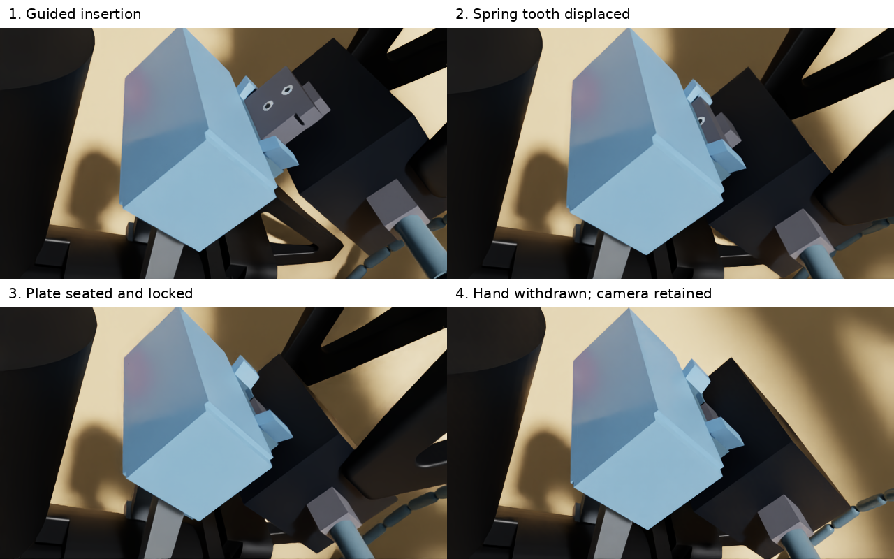
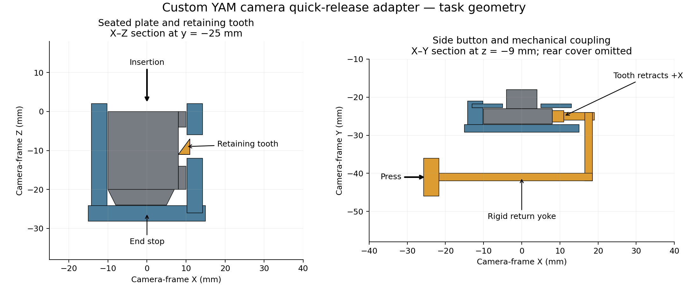

# Reattach your detached wrist camera

A live left-wrist camera rests on the table, still connected to the arm by its USB cable. The robot retrieves the module and reinstalls it at its original optical mounting pose. Both arms may move: one can present the receiving wrist while the other aligns, inserts and releases the camera.

**Instruction:** Reattach the loose camera to its mount on your left wrist. Release it once it is secured.

**Domain: Impact on AI timelines.** The task tests restoration of the robot’s own sensing hardware. It combines handling a cable-tethered camera with coordinated insertion and released retention on the robot’s wrist, targeting automation of robot hardware installation and maintenance.

## Specified hardware

The embodiment is the program’s bimanual YAM station fitted with a custom camera quick-release adapter. The receiver is screw-fastened to the wrist bracket; the mating plate is screw-fastened to the camera housing. These assemblies remain intact during the task. Recovery reconnects the plate and receiver.

The keyed plate enters a tapered mouth and slides between interlocking guide lips to an end stop. Its leading ramp displaces a spring-loaded tooth. At the seated position, the tooth returns into the plate notch. Pressing the left-side button moves a rigid return yoke behind the receiver and retracts the tooth on the opposite side.

The operating principle follows the [Falcam F22 push-to-attach/press-to-detach system](https://falcamstore.com/pages/f22-introduction). The task specifies its own adapter geometry. The [YAM station hardware](https://i2rt.com/products/yam-teleoperation-stations) supports camera integration through camera-mount CAD; this task’s quick-release adapter is a defined accessory on that bimanual platform.





| Component | Specification |
|---|---|
| Robot bases | (0,+0.305,0.750) m and (0,−0.305,0.750) m |
| Initial arm joints | [0,1,1,−0.6,0,0] rad on both arms; grippers open |
| Table | 1.10 × 1.30 × 0.06 m; centre (0.36,0,0.7175) m; top z=0.7475 m |
| Camera housing | 40 × 36 × 28 mm,55 g; initial origin (0.36,−0.19,0.7725) m, identity rotation, settling onto the table; lens on +Y |
| Camera plate | Nominal20 mm width,4 mm thickness,24 mm insertion length; tapered leading nose and side retaining notch |
| Receiver | Nominal20.4 mm internal guide width, retaining lips and end stop;0.2 mm nominal side clearance |
| Retaining mechanism | 3 × 3 × 4 mm tooth;5 mm transverse slider travel;150 N/m spring,0.15 N s/m damping |
| Camera cable | Nominal0.74 m,6 mm diameter; side USB connector and boot on camera, opposite end connected to a strain-relief block on left link2 |
| Context objects | Apple66 mm/120 g at XY(0.30,0.28) m; orange64 mm/110 g at XY(0.40,0.26) m; mesh bases placed on table |

Part centres, sizes, notch, guide and button geometry are specified in `mechanism_dimensions.json`, `latch_geometry.py`, `quick_release.py` and `wrist_adapter.py`. `MECHANISM.md` describes permanent fastenings and spring-guide assembly. The cable construction and attachments are in `camera_tether.py` and `cable_usd.py`. Fruit is scene context, not a manipulation goal. The floor, lighting and top-camera stand use the pinned station calibration.

The original camera-to-gripper optical target is stored in `native_camera_target.json`. Moving the receiving arm changes the mount’s world pose while preserving that wrist-relative target. The detached camera feed follows its physical housing; the top and right-wrist feeds remain available. Cable connectors remain attached throughout retrieval and reinstallation.

## Scoring

| Score | Condition |
|---|---|
| 0 | No condition below is achieved, or the camera body origin falls below tabletop−50 mm. A below-table drop invalidates all credit. |
| 0.25 | Housing-and-plate reference box is entirely more than20 mm above the table for1 s while supported near the closing gripper. Pickup credit persists unless invalidated. |
| 0.50 | Optical position error is within5 mm and rotation error within5° of the original mount for1 s while held or secured. |
| 0.75 | Verified channel entry, seating and current latch engagement, with alignment maintained. |
| 1.00 | Alignment, retention and live frame delivery persist for2 s after the supporting hand’s TCP is more than80 mm from the reference box. |

The reference box is X∈[−20,20], Y∈[−27,18], Z∈[−24,14] mm in the camera body frame. Lift and proximity checks use this housing-and-plate box; the side USB plug, strain-relief boot and flexible cable are excluded. Higher conditions take precedence. Alignment/release intervals reset when their conditions cease to hold. The endpoint posture of either arm is unrestricted.

For physical scoring, use a ruler and video to measure lift and hand withdrawal. Mark reference lines on the camera plate and receiver before detachment. Two perpendicular ruler-calibrated photographs and a5° angle template check pose against the seated reference. Inspect tooth engagement and observe retention for2 s after release. Check that the image stream is live using advancing timestamps and a changing test card.

The simulation insertion monitor records channel entry and seating at1.2 mm transverse/seat tolerance,3° rotation tolerance and receiver-relative speed below30 mm/s. Current tooth displacement and camera pose determine engagement. This monitor observes the assembly; the physical guide, stop and tooth retain the camera.

## Install and run

Use the program’s YAM Isaac environment on Linux with an RTX GPU. Tested stack: Isaac Sim6.1, Isaac Lab3 and Isaac Lab Arena0.3.1. Activate its `yam.env`. The pinned environment commit, source locator and [official installation walkthrough](https://tasks.robocurve.org/walkthrough) are in `dependencies.json` and `dependencies.py`. Python dependencies include NumPy, SciPy and Pillow; video export uses ffmpeg.

From this task directory:

```bash
python test_scorer.py
python test_runtime_checks.py
python test_plate_path.py
python run_demo.py --out ./runs/demo
python render_review.py ./runs/demo ./review/demo
python run_dream.py --max-steps 1800 --rows-per-request 4 --out ./runs/dream
python render_review.py ./runs/dream ./review/model
```

Configure `DREAM_API_KEY` privately before running Dream-1. Its inputs are the three native320 × 176 RGB feeds and measured14D joint/gripper state. The model controls both arms at20 Hz; its limit is1800 control steps,90 simulated seconds. API waits pause simulation. Four action rows are requested per call. A startup expiry before the first model response can be retried; after model inference begins, session loss aborts the run.

Start each trial in a fresh process with the fixed scene and no layout jitter. `asset_mirror.py` locates the same versioned fruit assets on NVIDIA’s production endpoint. The renderer writes the three synchronized native views and a separate mechanism detail view. Published evidence is `setup.png`, `demo.mp4`, `model_run.mp4` and the supplementary `installation_detail.mp4` and `insertion_closeup.mp4`.

For reset, support the camera, press the side button to retract the tooth, and slide the plate out of the receiver. Place the connected camera at its specified initial pose, restore initial arm joints and open the grippers. Both cable connectors remain attached.

## Recorded results

Scripted demo: **1.0**. The revised cable-connected installation remains secured for over10 s after hand withdrawal and while the receiving arm returns to its working posture. Final optical position error is approximately0.76 mm. See `evidence/demo_result.json`.

The Dream-1 recording for this revised hardware completed1800 control steps in one session, scoring **0.00**. See `model_run.mp4` and `evidence/model_summary.json`.

## Assets and licenses

Task-authored procedural geometry and code use the MIT license in `LICENSE`. Third-party assets retain their upstream licenses:

| Asset | Source | License |
|---|---|---|
| YAM robot meshes/URDF/collision geometry | I2RT model through the program YAM environment | MIT; `licenses/YAM_MIT.txt` |
| Apple `apple_01_objaverse_robolab` | RoboLab `assets/objects/objaverse/apple_01` | CC BY-NC-SA4.0, © NVIDIA Corporation |
| Orange `orange_02_fruits_veggies_robolab` | RoboLab `assets/objects/fruits_veggies/orange_02` | CC BY-NC-SA4.0, © NVIDIA Corporation |
| Housing, plate, receiver, tooth, button, yoke, supports, fasteners and cable | Task-authored procedural geometry | MIT; no imported product mesh |
| Table, floor, camera stand and lighting | Program environment’s procedural primitives | External environment dependency |

The [RoboLab notices](https://github.com/NVlabs/RoboLab/blob/main/THIRD_PARTY_NOTICES.md) are archived in `licenses/ROBOLAB_THIRD_PARTY_NOTICES.md`; `ASSETS.md` lists sources and attribution. External meshes and textures are loaded as dependencies rather than redistributed in this archive. The YAM wrapper README states that the wrapper has no repository license yet; the bundled robot model is separately MIT. Isaac Lab-Arena and Isaac Sim retain their upstream terms. The task’s MIT grant applies to task-authored files.

## Simulation fidelity

Housing, plate, receiver, tooth, button, yoke and cable have contact geometry. Spring return is represented by a prismatic-joint drive; cable bending uses elastic D6 joints. Permanently bolted assemblies are compound rigid bodies. Retention results from guide/tooth contact with the plate. The optical sensor follows the camera housing. Held support is approximated by a closing-gripper command and TCP-to-reference-box distance below50 mm, together with sustained lift. Fruit uses rigid contact.
